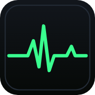

<div align="center">



# CEN Study Hub & EKG Rhythm Trainer

**A free study hub for the BCEN Certified Emergency Nurse (CEN) exam, with an EKG rhythm trainer that runs real code scenarios stage by stage.**

[**Open the Study Hub →**](https://jeremiyakerson-cpu.github.io/work-flow/) · [**Go straight to the EKG trainer →**](https://jeremiyakerson-cpu.github.io/work-flow/ekg-test.html)


</div>

---

## What it does

- **CEN domain board:** tracks your progress across the BCEN content outline (effective 07/06/2026) and flags priority topics.
- **EKG rhythm trainer:** synthesizes waveforms on a monitor, so you learn to read a strip rather than memorize a picture.
- **Code scenarios:** cases unfold stage by stage, and the rhythm changes based on your choices. They include a witnessed VF arrest, torsades losing its pulse, PEA where you have to find the cause, unstable SVT, Afib with RVR, crashing chest trauma, and the dialysis no-show.
- **Practice questions and sprints:** each question has a rationale, and stats show where you're weak.
- **Study guide and code log:** a reference for each rhythm, plus a running log of your scenario decisions.
- **Works offline:** it installs to your phone and keeps working on a dead-zone shift.

## Clinical content you can trust is tested

Every rhythm, question and scenario is checked automatically on every pull request. Each rhythm has to
produce a sane waveform, and each question needs distinct choices, a valid keyed answer and a rationale.
Every rhythm a scenario mentions must exist and have a study-guide entry. The end-to-end suite then
plays every question and scenario through the real UI, on desktop and on a 375px phone, with
accessibility and offline checks.

> **Educational use only.** This doesn't replace ACLS/ENPC training, your facility's protocols or clinical judgment.

## About the author

Built by **Jeremi Yakerson, BSN, RN**, an ER nurse with nearly 10 years in emergency and critical care,
including work as a charge nurse. See also [Pulse & Protocol](https://github.com/jeremiyakerson-cpu/Pulse-Protocol),
free offline ER dosing and quiz tools.

---

# For developers

## EKG trainer — running & testing

The app is plain static files (no build step): open `ekg-test.html` from any static server,
e.g. `npm run serve` → http://localhost:4173/ekg-test.html.

Tests are dev-only:

```sh
npm install          # installs @playwright/test only
npm test             # unit (node --test) + e2e (Playwright, desktop + 375px mobile)
npm run test:unit    # pure logic & content/precache checks, no browser
npm run test:e2e     # smoke, mobile layout, offline/PWA, accessibility
```

In this dev container Playwright uses the preinstalled Chromium via `PLAYWRIGHT_BROWSERS_PATH`
(or set `CHROMIUM_PATH=/path/to/chrome`). Elsewhere, run `npx playwright install chromium` once.
CI (`.github/workflows/ekg-tests.yml`) runs both suites on every pull request.

**Content is tested automatically.** The unit and e2e suites loop over the data files, so new
content needs no new tests: every rhythm must synthesize a sane waveform, every question and
scenario stage needs distinct choices, an in-range answer and a rationale, every rhythm they
reference must exist (and have a study-guide entry), every generator arc must produce valid cases,
and the e2e suite plays every question and authored scenario through the real UI with the keyed
answer.

**Offline.** Every app file at the repo root (`*.html`, `*.js`, `*.css`, icons, the manifest) must
be listed in `CORE_ASSETS` in `service-worker.js`; `tests/unit/service-worker.test.js` fails
otherwise. Bump `CACHE_VERSION` when you change that list or the page shell.
